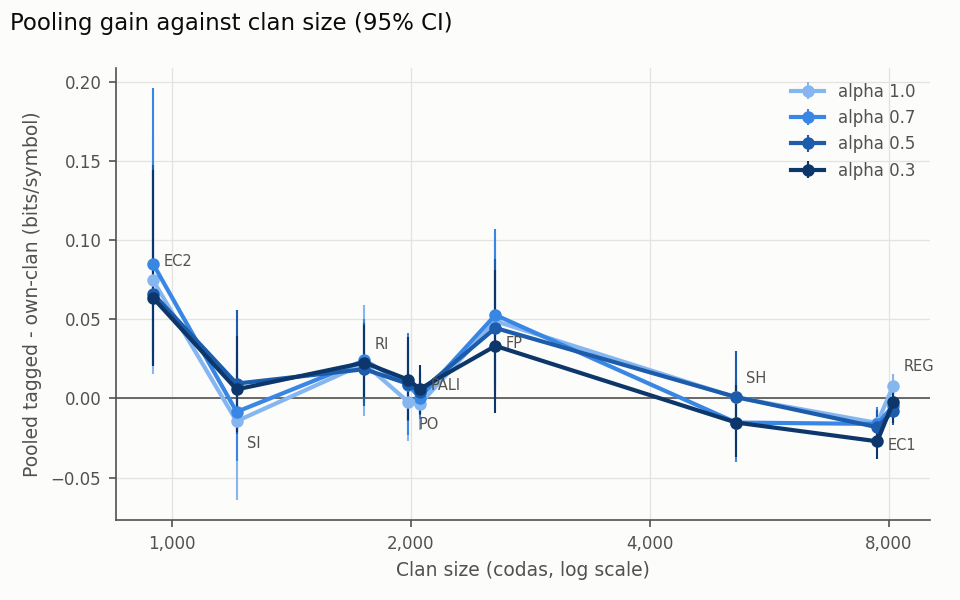
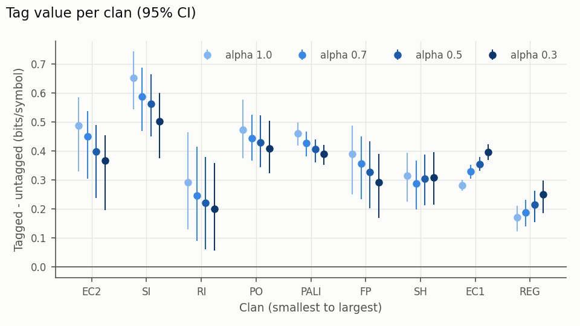
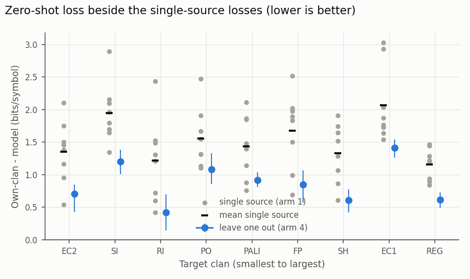
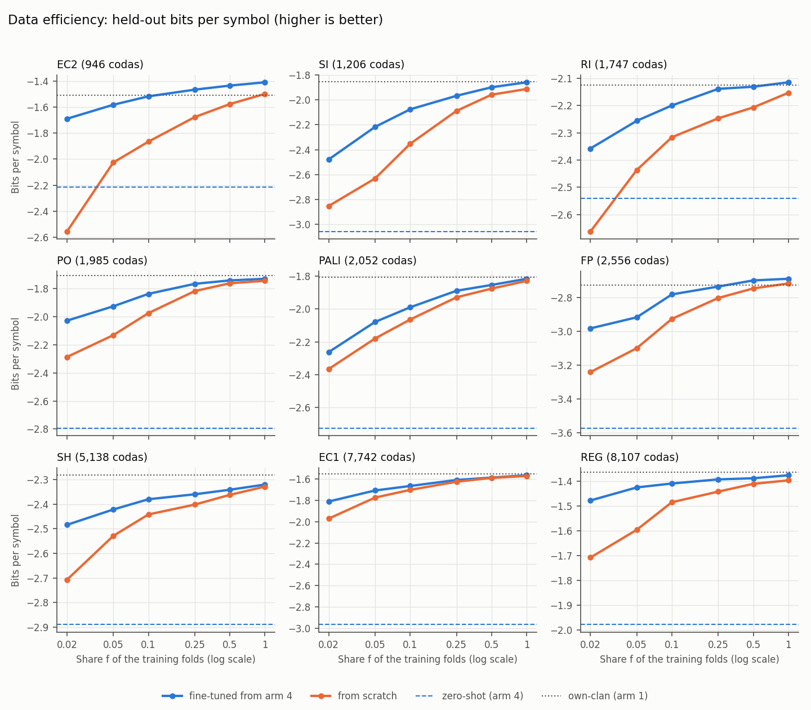
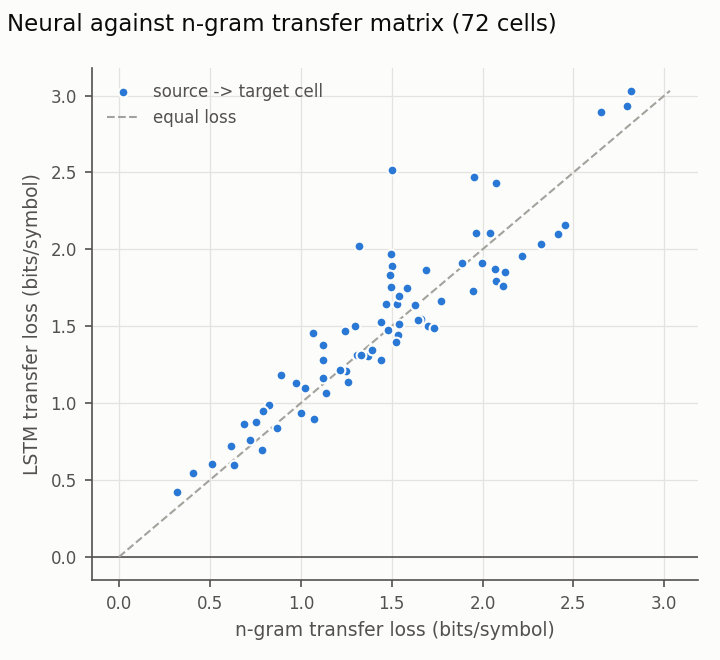

# RQ3 pooled multi-clan LSTM (`[R3-8]`, DEC-27)

Generated by `python -m whale_coda_dynamics.rq3_neural.runner --stage report` from the stage outputs in `data/results/rq3_neural/`; do not edit. Every score uses the `[R3-1]` tokeniser (`fixed-50ms-v1`), the `[R3-2]` folds and Vlad's `[R3-3]` aggregation and group bootstrap (1,000 draws over the target clan's recording groups). Contrasts are in bits per symbol, paired on the same codas; positive means the first model is better. Claims are limited to how much other clans' codas help model a clan and how much knowing the clan is worth, in bits; nothing about shared ancestry, learning between clans, or meaning.

## Runs

| Stage | Commit | Device | Workers | Fits | Wall minutes | Fit hours (sum over workers) |
|---|---|---|---:|---:|---:|---:|
| pilot | 9a5d723e7c | cpu+gpu |  | 24 | 4.7 | 0.18 |
| arm1 | aa783bb635 | cuda | 4 | 552 | 4.4 | 0.28 |
| arm23 | 471a923597 | cuda | 4 | 576 | 37.5 | 2.46 |
| capacity | 74503e24d8 | cuda | 4 | 96 | 4.9 | 0.31 |
| arm4 | d1b7f981c9 | cuda | 4 | 108 | 6.9 | 0.43 |
| arm5 | 35cb7f8964 | cuda | 4 | 3,312 | 12.3 | 0.81 |

Total wall time of the fitting stages: 1.18 hours.

## Gate 0: coda counts

Coda counts per clan and fold from the codas file, from `rq3_folds.csv` and in the encoded data. All match (the runner raises otherwise).

| Clan | Folds | Codas per fold | Codas | Match |
|---|---:|---|---:|---|
| EC1 | 5 | 1550 / 1549 / 1547 / 1549 / 1547 | 7742 | yes |
| EC2 | 6 | 363 / 143 / 133 / 129 / 116 / 62 | 946 | yes |
| FP | 5 | 508 / 506 / 505 / 534 / 503 | 2556 | yes |
| PALI | 5 | 409 / 408 / 409 / 404 / 422 | 2052 | yes |
| PO | 5 | 442 / 380 / 382 / 405 / 376 | 1985 | yes |
| REG | 5 | 1962 / 1522 / 1541 / 1542 / 1540 | 8107 | yes |
| RI | 5 | 346 / 342 / 349 / 340 / 370 | 1747 | yes |
| SH | 5 | 1027 / 1022 / 1031 / 1029 / 1029 | 5138 | yes |
| SI | 5 | 237 / 251 / 249 / 232 / 237 | 1206 | yes |

## Pilot, device and compute

Pilot fits: EC2 fold 0 (own-clan) and pooled run 0 (alpha 0.7, tagged) over the full grid, then the refits; no held-out coda was scored. Throughput: 3-epoch fits of the pooled run, one per worker, all running at once.

| Device | Workers | Hidden | Draws per second |
|---|---:|---:|---:|
| cpu | 10 | 32 | 119,190 |
| cpu | 10 | 64 | 76,308 |
| cpu | 10 | 128 | 36,386 |
| cpu | 18 | 32 | 121,152 |
| cpu | 18 | 64 | 76,750 |
| cpu | 18 | 128 | 35,793 |
| cuda | 1 | 32 | 31,198 |
| cuda | 1 | 64 | 33,477 |
| cuda | 1 | 128 | 33,056 |
| cuda | 4 | 32 | 94,948 |
| cuda | 4 | 64 | 104,635 |
| cuda | 4 | 128 | 87,137 |

| Determinism check | Identical |
|---|---|
| cpu | True |
| cuda | True |

Chosen: **cuda with 4 workers**. Projected wall time 0.98 h (arm1 0.08 h, arm23 0.44 h, arm4 0.09 h, arm5 0.36 h; the gate rerun and the capacity check are not included). Within the 6 h budget: arm 5 runs in full (f in [0.02, 0.05, 0.1, 0.25, 0.5, 1.0], 3 draws).

## Gate 1: own-clan LSTM against the own-clan n-gram

Per clan, own-clan LSTM minus own-clan n-gram (`[R3-4]` diagonal, Vlad's `self_scores.csv`) on the same codas. A clan fails when the CI lies entirely below zero.

**First run** (passed):

| Clan | Codas | Groups | n-gram bits/symbol | LSTM bits/symbol | LSTM - n-gram [95% CI] | Gate |
|---|---:|---:|---:|---:|---:|---|
| EC1 | 7742 | 91 | -1.659 | -1.553 | +0.106 [+0.082, +0.129] | pass |
| EC2 | 946 | 6 | -1.630 | -1.509 | +0.121 [-0.006, +0.185] | pass |
| FP | 2556 | 26 | -2.871 | -2.726 | +0.145 [+0.092, +0.198] | pass |
| PALI | 2052 | 15 | -2.004 | -1.807 | +0.197 [+0.176, +0.218] | pass |
| PO | 1985 | 15 | -1.848 | -1.708 | +0.140 [+0.119, +0.154] | pass |
| REG | 8107 | 50 | -1.444 | -1.363 | +0.081 [+0.035, +0.125] | pass |
| RI | 1747 | 19 | -2.222 | -2.124 | +0.098 [+0.057, +0.151] | pass |
| SH | 5138 | 50 | -2.356 | -2.283 | +0.073 [+0.050, +0.093] | pass |
| SI | 1206 | 16 | -1.956 | -1.853 | +0.103 [+0.067, +0.139] | pass |

Later arms use `arm1`.

## Settings chosen on inner validation

| Arm | Models | Hidden/dropout chosen | Mean best epoch | Range |
|---|---:|---|---:|---|
| Arm 1 (own-clan) | 46 | h128/d0.0 x6, h128/d0.2 x11, h128/d0.4 x6, h32/d0.0 x3, h32/d0.4 x2, h64/d0.0 x7, h64/d0.2 x6, h64/d0.4 x5 | 19.9 | 4-59 |
| Arm 2 (pooled, tagged) | 24 | h128/d0.2 x8, h128/d0.4 x9, h64/d0.0 x1, h64/d0.2 x5, h64/d0.4 x1 | 13.0 | 7-30 |
| Arm 3 (pooled, untagged) | 24 | h128/d0.2 x5, h128/d0.4 x9, h32/d0.0 x1, h32/d0.2 x1, h64/d0.0 x3, h64/d0.2 x1, h64/d0.4 x4 | 13.8 | 5-36 |
| Arm 4 (leave one out) | 9 | h128/d0.2 x4, h128/d0.4 x1, h64/d0.2 x2, h64/d0.4 x2 | 11.4 | 6-18 |

## Neural 9 x 9 transfer matrix (arm 1)

Transfer loss G(s, t) = own-clan LSTM - transfer score from s (mean of s's fold models), bits per symbol, rows = source, columns = target. Its rank correlation with the n-gram matrix (`[R3-4]`, the 72 off-diagonal cells): **Spearman rho = +0.903** (p = 2.5e-27).

| Source \ target | EC1 | EC2 | FP | PALI | PO | REG | RI | SH | SI | Training codas |
|---|---:|---:|---:|---:|---:|---:|---:|---:|---:|---:|
| EC1 | 0 | 1.50 | 2.52 | 1.48 | 2.47 | 1.45 | 1.21 | 1.64 | 2.89 | 6193 |
| EC2 | 2.04 | 0 | 1.89 | 1.85 | 1.55 | 0.89 | 1.49 | 1.91 | 2.16 | 788 |
| FP | 1.73 | 1.45 | 0 | 1.14 | 1.13 | 1.18 | 0.60 | 0.86 | 1.64 | 2044 |
| PALI | 1.87 | 2.10 | 2.02 | 0 | 1.91 | 1.47 | 0.72 | 1.28 | 1.96 | 1641 |
| PO | 3.03 | 1.16 | 1.50 | 2.11 | 0 | 0.93 | 2.43 | 1.75 | 1.79 | 1588 |
| REG | 1.76 | 0.54 | 1.83 | 1.40 | 1.31 | 0 | 1.31 | 1.51 | 2.10 | 6485 |
| RI | 1.64 | 1.75 | 0.69 | 0.76 | 1.31 | 1.28 | 0 | 0.60 | 1.70 | 1397 |
| SH | 1.54 | 1.38 | 0.99 | 0.88 | 1.10 | 0.84 | 0.42 | 0 | 1.35 | 4110 |
| SI | 2.93 | 0.95 | 1.97 | 1.86 | 1.67 | 1.22 | 1.53 | 1.07 | 0 | 964 |

n-gram losses for the same cells, from Vlad's scores:

| Source \ target | EC1 | EC2 | FP | PALI | PO | REG | RI | SH | SI |
|---|---:|---:|---:|---:|---:|---:|---:|---:|---:|
| EC1 | 0 | 1.70 | 1.50 | 1.48 | 1.96 | 1.53 | 1.25 | 1.53 | 2.65 |
| EC2 | 2.32 | 0 | 1.50 | 2.12 | 1.66 | 1.07 | 1.73 | 2.00 | 2.45 |
| FP | 1.95 | 1.07 | 0 | 1.26 | 0.97 | 0.89 | 0.63 | 0.68 | 1.47 |
| PALI | 2.07 | 1.97 | 1.32 | 0 | 1.89 | 1.25 | 0.61 | 1.44 | 2.22 |
| PO | 2.82 | 1.12 | 1.30 | 2.04 | 0 | 1.00 | 2.07 | 1.58 | 2.07 |
| REG | 2.11 | 0.41 | 1.49 | 1.53 | 1.31 | 0 | 1.37 | 1.54 | 2.42 |
| RI | 1.63 | 1.49 | 0.78 | 0.72 | 1.33 | 1.12 | 0 | 0.51 | 1.54 |
| SH | 1.64 | 1.12 | 0.83 | 0.76 | 1.03 | 0.87 | 0.32 | 0 | 1.39 |
| SI | 2.80 | 0.79 | 1.49 | 1.69 | 1.77 | 1.22 | 1.44 | 1.14 | 0 |

Neural losses with a CI that includes or lies below zero: 0 of 72 (smallest lower bound: SH -> RI, +0.419 [+0.209, +0.644]). CIs for every cell are in `data/results/rq3_neural/report/matrix.csv`.

## Pooled arms: sampling exponent alpha

Clan-averaged inner-validation bits per symbol (clans weighted equally) of each run's chosen fit. Primary alpha: **arm 2 0.7**, **arm 3 0.3** (arm 4 uses arm 3's).

| Arm | alpha 1.0 | alpha 0.7 | alpha 0.5 | alpha 0.3 |
|---|---:|---:|---:|---:|
| arm2 | -1.8735 | -1.8706 | -1.8727 | -1.8777 |
| arm3 | -2.2630 | -2.2406 | -2.2232 | -2.2140 |

## Pooling gain: pooled tagged - own-clan

Per target clan, every alpha (bits per symbol, 95% CI). Clan sizes: EC2 946, SI 1,206, RI 1,747, PO 1,985, PALI 2,052, FP 2,556, SH 5,138, EC1 7,742, REG 8,107.

| Clan | alpha 1.0 | alpha 0.7 | alpha 0.5 | alpha 0.3 |
|---|---:|---:|---:|---:|
| EC1 | -0.016 [-0.024, -0.007] | -0.016 [-0.027, -0.005] | -0.018 [-0.029, -0.007] | -0.027 [-0.038, -0.016] |
| EC2 | +0.075 [+0.015, +0.166] | +0.085 [+0.029, +0.196] | +0.066 [+0.021, +0.147] | +0.064 [+0.021, +0.144] |
| FP | +0.049 [+0.004, +0.103] | +0.053 [+0.007, +0.107] | +0.045 [-0.001, +0.088] | +0.033 [-0.009, +0.081] |
| PALI | -0.004 [-0.020, +0.011] | +0.000 [-0.013, +0.015] | +0.004 [-0.010, +0.017] | +0.006 [-0.010, +0.021] |
| PO | -0.002 [-0.027, +0.017] | +0.009 [-0.023, +0.041] | +0.009 [-0.014, +0.033] | +0.012 [-0.013, +0.039] |
| REG | +0.008 [+0.000, +0.015] | -0.005 [-0.013, +0.008] | -0.008 [-0.017, +0.004] | -0.002 [-0.015, +0.007] |
| RI | +0.022 [-0.011, +0.059] | +0.024 [-0.003, +0.050] | +0.019 [-0.005, +0.048] | +0.023 [+0.001, +0.046] |
| SH | +0.001 [-0.019, +0.024] | -0.015 [-0.040, +0.011] | +0.001 [-0.027, +0.030] | -0.015 [-0.037, +0.009] |
| SI | -0.014 [-0.064, +0.045] | -0.008 [-0.040, +0.029] | +0.009 [-0.023, +0.056] | +0.006 [-0.021, +0.040] |

## Tag value: pooled tagged - pooled untagged

The conditional V-information of the clan given the coda so far, in bits per symbol.

| Clan | alpha 1.0 | alpha 0.7 | alpha 0.5 | alpha 0.3 |
|---|---:|---:|---:|---:|
| EC1 | +0.282 [+0.263, +0.301] | +0.329 [+0.305, +0.352] | +0.355 [+0.331, +0.380] | +0.396 [+0.370, +0.424] |
| EC2 | +0.489 [+0.329, +0.586] | +0.451 [+0.306, +0.539] | +0.400 [+0.239, +0.491] | +0.366 [+0.196, +0.456] |
| FP | +0.389 [+0.250, +0.488] | +0.356 [+0.234, +0.450] | +0.329 [+0.202, +0.434] | +0.292 [+0.168, +0.391] |
| PALI | +0.462 [+0.419, +0.498] | +0.427 [+0.382, +0.468] | +0.406 [+0.362, +0.441] | +0.390 [+0.353, +0.422] |
| PO | +0.474 [+0.376, +0.578] | +0.445 [+0.368, +0.526] | +0.431 [+0.344, +0.523] | +0.410 [+0.323, +0.504] |
| REG | +0.171 [+0.124, +0.210] | +0.188 [+0.139, +0.233] | +0.215 [+0.156, +0.264] | +0.250 [+0.187, +0.299] |
| RI | +0.291 [+0.131, +0.465] | +0.247 [+0.091, +0.414] | +0.222 [+0.061, +0.380] | +0.201 [+0.056, +0.358] |
| SH | +0.315 [+0.227, +0.395] | +0.288 [+0.198, +0.367] | +0.306 [+0.214, +0.388] | +0.308 [+0.215, +0.396] |
| SI | +0.653 [+0.545, +0.744] | +0.588 [+0.470, +0.689] | +0.563 [+0.450, +0.665] | +0.503 [+0.376, +0.602] |

## Lower alpha: arm 2 at alpha 0.3 - arm 2 at alpha 1.0

| Clan | alpha 0.3 - alpha 1.0 |
|---|---:|
| EC1 | -0.012 [-0.015, -0.007] |
| EC2 | -0.011 [-0.049, +0.025] |
| FP | -0.016 [-0.052, +0.016] |
| PALI | +0.010 [-0.007, +0.026] |
| PO | +0.014 [+0.004, +0.024] |
| REG | -0.010 [-0.025, +0.001] |
| RI | +0.001 [-0.020, +0.019] |
| SH | -0.016 [-0.030, -0.003] |
| SI | +0.020 [-0.010, +0.053] |

## Capacity check

Pooled tagged was reliably below own-clan for some clan at alpha [1.0, 0.7, 0.5, 0.3]; arm 2 was rerun there with 2x the chosen hidden size. Both are reported:

| Clan | alpha 1.0: chosen / doubled | alpha 0.7: chosen / doubled | alpha 0.5: chosen / doubled | alpha 0.3: chosen / doubled |
|---|---:|---:|---:|---:|
| EC1 | -0.016 [-0.024, -0.007] / -0.015 [-0.024, -0.004] | -0.016 [-0.027, -0.005] / -0.019 [-0.031, -0.008] | -0.018 [-0.029, -0.007] / -0.021 [-0.034, -0.008] | -0.027 [-0.038, -0.016] / -0.027 [-0.037, -0.017] |
| EC2 | +0.075 [+0.015, +0.166] / +0.078 [+0.015, +0.185] | +0.085 [+0.029, +0.196] / +0.079 [+0.025, +0.156] | +0.066 [+0.021, +0.147] / +0.066 [+0.014, +0.149] | +0.064 [+0.021, +0.144] / +0.064 [+0.021, +0.142] |
| FP | +0.049 [+0.004, +0.103] / +0.048 [+0.000, +0.102] | +0.053 [+0.007, +0.107] / +0.035 [-0.001, +0.077] | +0.045 [-0.001, +0.088] / -0.010 [-0.054, +0.038] | +0.033 [-0.009, +0.081] / +0.014 [-0.032, +0.064] |
| PALI | -0.004 [-0.020, +0.011] / -0.002 [-0.019, +0.012] | +0.000 [-0.013, +0.015] / +0.004 [-0.007, +0.012] | +0.004 [-0.010, +0.017] / +0.005 [-0.007, +0.016] | +0.006 [-0.010, +0.021] / -0.003 [-0.013, +0.007] |
| PO | -0.002 [-0.027, +0.017] / +0.006 [-0.017, +0.029] | +0.009 [-0.023, +0.041] / -0.000 [-0.023, +0.023] | +0.009 [-0.014, +0.033] / +0.006 [-0.014, +0.028] | +0.012 [-0.013, +0.039] / +0.005 [-0.024, +0.042] |
| REG | +0.008 [+0.000, +0.015] / -0.012 [-0.021, -0.001] | -0.005 [-0.013, +0.008] / -0.001 [-0.011, +0.009] | -0.008 [-0.017, +0.004] / -0.005 [-0.013, +0.006] | -0.002 [-0.015, +0.007] / -0.011 [-0.019, -0.001] |
| RI | +0.022 [-0.011, +0.059] / +0.011 [-0.010, +0.038] | +0.024 [-0.003, +0.050] / +0.026 [+0.003, +0.056] | +0.019 [-0.005, +0.048] / +0.016 [-0.003, +0.040] | +0.023 [+0.001, +0.046] / +0.016 [-0.002, +0.039] |
| SH | +0.001 [-0.019, +0.024] / -0.002 [-0.023, +0.020] | -0.015 [-0.040, +0.011] / -0.009 [-0.030, +0.013] | +0.001 [-0.027, +0.030] / -0.005 [-0.027, +0.022] | -0.015 [-0.037, +0.009] / -0.009 [-0.025, +0.009] |
| SI | -0.014 [-0.064, +0.045] / -0.013 [-0.047, +0.034] | -0.008 [-0.040, +0.029] / +0.004 [-0.020, +0.036] | +0.009 [-0.023, +0.056] / +0.006 [-0.021, +0.045] | +0.006 [-0.021, +0.040] / -0.004 [-0.038, +0.042] |

## Zero-shot: leave one clan out (arm 4)

Untagged, trained on the other eight clans at arm 3's primary alpha (0.3). Zero-shot loss = own-clan - leave-one-out; beside it the single-source losses of arm 1 for the same target (the mean over the eight sources, and the best source, which is an oracle: it is chosen on the target's own scores).

| Target | Zero-shot loss | Mean single-source loss | Best single source (oracle) | Leave-one-out - mean single source |
|---|---:|---:|---|---:|
| EC1 | +1.415 [+1.264, +1.542] | +2.067 [+1.930, +2.197] | SH +1.537 [+1.344, +1.673] | +0.652 [+0.623, +0.685] |
| EC2 | +0.706 [+0.429, +0.851] | +1.355 [+1.176, +1.458] | REG +0.543 [+0.457, +0.597] | +0.650 [+0.598, +0.740] |
| FP | +0.846 [+0.571, +1.067] | +1.677 [+1.355, +1.952] | RI +0.692 [+0.496, +0.859] | +0.831 [+0.749, +0.921] |
| PALI | +0.918 [+0.808, +1.035] | +1.435 [+1.348, +1.506] | RI +0.761 [+0.640, +0.860] | +0.517 [+0.478, +0.553] |
| PO | +1.085 [+0.854, +1.332] | +1.556 [+1.327, +1.810] | SH +1.101 [+0.863, +1.383] | +0.472 [+0.460, +0.485] |
| REG | +0.615 [+0.488, +0.724] | +1.158 [+1.031, +1.253] | SH +0.839 [+0.700, +0.973] | +0.543 [+0.503, +0.605] |
| RI | +0.417 [+0.142, +0.695] | +1.213 [+0.951, +1.485] | SH +0.419 [+0.209, +0.644] | +0.796 [+0.744, +0.851] |
| SH | +0.606 [+0.418, +0.776] | +1.329 [+1.111, +1.536] | RI +0.604 [+0.409, +0.798] | +0.723 [+0.674, +0.763] |
| SI | +1.204 [+1.009, +1.383] | +1.949 [+1.703, +2.202] | SH +1.347 [+1.089, +1.538] | +0.745 [+0.657, +0.863] |

## Data efficiency (arm 5)

Arm 4's model fine-tuned on a share f of the target clan's training folds, against the same architecture from scratch on the same codas; learning rate and early stopping on the full inner-validation fold, scored as stopped. 3 draw(s) per f. Models stopped at epoch 0 (the starting weights): 0.

**Fine-tuned - from scratch:**

| Clan | f 0.02 | f 0.05 | f 0.1 | f 0.25 | f 0.5 | f 1.0 |
|---|---:|---:|---:|---:|---:|---:|
| EC1 | +0.161 [+0.124, +0.190] | +0.067 [+0.049, +0.086] | +0.037 [+0.024, +0.051] | +0.016 [+0.008, +0.028] | +0.003 [-0.003, +0.011] | +0.007 [+0.003, +0.010] |
| EC2 | +0.868 [+0.690, +0.998] | +0.444 [+0.291, +0.525] | +0.348 [+0.249, +0.417] | +0.211 [+0.131, +0.271] | +0.142 [+0.071, +0.247] | +0.089 [+0.043, +0.168] |
| FP | +0.259 [+0.165, +0.371] | +0.183 [+0.087, +0.293] | +0.145 [+0.051, +0.270] | +0.068 [+0.009, +0.133] | +0.047 [-0.008, +0.106] | +0.028 [-0.015, +0.081] |
| PALI | +0.103 [+0.041, +0.171] | +0.101 [+0.065, +0.130] | +0.074 [+0.043, +0.096] | +0.040 [+0.019, +0.059] | +0.022 [+0.008, +0.037] | +0.013 [-0.003, +0.026] |
| PO | +0.259 [+0.132, +0.396] | +0.205 [+0.047, +0.400] | +0.137 [+0.031, +0.266] | +0.052 [+0.018, +0.085] | +0.020 [+0.007, +0.030] | +0.015 [+0.002, +0.024] |
| REG | +0.231 [+0.150, +0.297] | +0.171 [+0.102, +0.219] | +0.076 [+0.017, +0.121] | +0.049 [+0.027, +0.067] | +0.022 [+0.004, +0.038] | +0.021 [+0.003, +0.033] |
| RI | +0.305 [+0.181, +0.433] | +0.181 [+0.057, +0.265] | +0.117 [+0.010, +0.205] | +0.108 [+0.014, +0.189] | +0.076 [-0.028, +0.180] | +0.038 [-0.045, +0.120] |
| SH | +0.223 [+0.123, +0.316] | +0.107 [+0.045, +0.168] | +0.062 [+0.021, +0.108] | +0.042 [+0.007, +0.082] | +0.021 [-0.002, +0.048] | +0.008 [-0.001, +0.018] |
| SI | +0.374 [+0.268, +0.518] | +0.414 [+0.302, +0.610] | +0.277 [+0.173, +0.442] | +0.121 [+0.073, +0.195] | +0.060 [+0.034, +0.088] | +0.054 [+0.026, +0.085] |

**Bits per symbol** (fine-tuned / from scratch; zero-shot = arm 4, own-clan = arm 1 trained on all its training folds):

| Clan | f 0.02 | f 0.05 | f 0.1 | f 0.25 | f 0.5 | f 1.0 | zero-shot | own-clan |
|---|---:|---:|---:|---:|---:|---:|---:|---:|
| EC1 | -1.810 / -1.971 | -1.706 / -1.773 | -1.664 / -1.701 | -1.607 / -1.624 | -1.585 / -1.588 | -1.563 / -1.570 | -2.967 | -1.553 |
| EC2 | -1.690 / -2.557 | -1.582 / -2.026 | -1.517 / -1.866 | -1.466 / -1.676 | -1.434 / -1.577 | -1.409 / -1.498 | -2.214 | -1.509 |
| FP | -2.983 / -3.242 | -2.918 / -3.100 | -2.782 / -2.927 | -2.736 / -2.804 | -2.700 / -2.747 | -2.690 / -2.718 | -3.573 | -2.726 |
| PALI | -2.262 / -2.366 | -2.079 / -2.180 | -1.990 / -2.064 | -1.889 / -1.929 | -1.854 / -1.876 | -1.816 / -1.829 | -2.725 | -1.807 |
| PO | -2.029 / -2.287 | -1.926 / -2.131 | -1.838 / -1.975 | -1.766 / -1.818 | -1.742 / -1.762 | -1.730 / -1.745 | -2.793 | -1.708 |
| REG | -1.477 / -1.707 | -1.424 / -1.595 | -1.408 / -1.484 | -1.392 / -1.441 | -1.387 / -1.409 | -1.375 / -1.395 | -1.978 | -1.363 |
| RI | -2.357 / -2.663 | -2.256 / -2.436 | -2.200 / -2.316 | -2.138 / -2.247 | -2.131 / -2.207 | -2.114 / -2.153 | -2.541 | -2.124 |
| SH | -2.484 / -2.707 | -2.422 / -2.529 | -2.380 / -2.442 | -2.360 / -2.402 | -2.342 / -2.362 | -2.321 / -2.329 | -2.889 | -2.283 |
| SI | -2.479 / -2.852 | -2.218 / -2.631 | -2.077 / -2.353 | -1.968 / -2.089 | -1.900 / -1.959 | -1.860 / -1.914 | -3.057 | -1.853 |

## Predictions against results

One row per `[R3-8]` prediction (written before running). The rule column gives the test, fixed in `rq3_neural/report.py` before any arm ran.

| Prediction | Rule | Result | Verdict |
|---|---|---|---|
| P1: Pooling gain is largest for the smallest clans (EC2, SI) and about zero for the largest (EC1, REG) | At arm 2's primary alpha: (a) the two smallest clans have the two largest pooling gains; (b) the two largest clans' 95% CIs contain zero. Both: supported; one: partly supported; neither: not supported. | alpha 0.7: largest gains EC2, FP (smallest clans EC2, SI); EC2 +0.085 [+0.029, +0.196]; SI -0.008 [-0.040, +0.029]; EC1 -0.016 [-0.027, -0.005]; REG -0.005 [-0.013, +0.008]; Spearman(size, gain) -0.57 | **not supported** |
| P2: Lower alpha helps small clans and costs large ones | Arm 2 at the lowest alpha minus arm 2 at alpha = 1, per clan. Supported: CI above zero for the two smallest clans and below zero for the two largest; direction only: all four point estimates have the predicted sign; partly: one to three do; not supported: none. | alpha 0.3 - alpha 1.0: EC2 -0.011 [-0.049, +0.025]; SI +0.020 [-0.010, +0.053]; EC1 -0.012 [-0.015, -0.007]; REG -0.010 [-0.025, +0.001]; 3/4 with the predicted sign, 1/4 reliably | **partly supported** |
| P3: Tag value is clearly positive for every clan | Tagged minus untagged at arm 2's primary alpha. Supported: CI above zero for all nine clans; partly: for some; not supported: for none. | alpha 0.7: CI above zero for 9/9 clans; smallest REG +0.188 [+0.139, +0.233]; largest SI +0.588 [+0.470, +0.689] | **supported** |
| P4: The leave-one-out model beats the mean single source | Leave-one-out minus the mean of the eight single-source transfer scores (arm 1), per target clan. Supported: CI above zero for all nine; partly: for some; not supported: for none. | CI above zero for 9/9 clans, point estimate above zero for 9/9; EC1 +0.652 [+0.623, +0.685]; EC2 +0.650 [+0.598, +0.740]; FP +0.831 [+0.749, +0.921]; PALI +0.517 [+0.478, +0.553]; PO +0.472 [+0.460, +0.485]; REG +0.543 [+0.503, +0.605]; RI +0.796 [+0.744, +0.851]; SH +0.723 [+0.674, +0.763]; SI +0.745 [+0.657, +0.863] | **supported** |
| P5: Fine-tuning helps most at small f, and the gap closes as f grows | Fine-tuned minus from scratch per clan and share. A clan agrees when (a) the CI at the smallest share is above zero and (b) the largest gain is at one of the two smallest shares and the gain at the largest share is below the gain at the smallest. Supported: all nine clans; partly: some; not supported: none. | 9/9 clans agree (EC1, EC2, FP, PALI, PO, REG, RI, SH, SI); gain at f = 0.02: EC1 +0.161; EC2 +0.868; FP +0.259; PALI +0.103; PO +0.259; REG +0.231; RI +0.305; SH +0.223; SI +0.374; at f = 1.0: EC1 +0.007; EC2 +0.089; FP +0.028; PALI +0.013; PO +0.015; REG +0.021; RI +0.038; SH +0.008; SI +0.054 | **supported** |

## Figures

Written by `python -m whale_coda_dynamics.rq3_neural.plots` from `data/results/rq3_neural/report/`.

## Interpretations

Where `[R3-8]` leaves a choice open, this run takes the reading closest to PLAN:

1. Score rows use PLAN `[R3-3]`'s columns. `ll_bits` is the coda's log2 probability, the same quantity and sign as Vlad's `bits_per_coda` (negative, higher is better); `n_symbols` is his `token_count` (intervals + `EOS`, checked equal for every coda and model). A row is the mean over the refit seeds; matrix rows are the mean over the source's fold models of their seed means (as `[R3-4]`). `group_id` for the bootstrap is joined from the codas file.
2. Selection fits use one seed (0); the chosen setting is refit with seeds 0, 1, 2 for the selected fit's best epoch (the number of epochs is kept, the number of draws per epoch follows the larger refit training set).
3. Training draws are independent and with replacement: clan c with probability proportional to n_c^alpha, then a coda uniformly within the clan. Single-clan models (arms 1 and 5) use the same sampler with one clan.
4. Early stopping and the choice of hidden size and dropout use the inner-validation bits per symbol over all inner-validation codas (sum of log2 probabilities over sum of symbols). Only alpha is chosen on the clan-averaged score, as `[R3-8]` says.
5. Primary alpha: for each run, the chosen setting's selection fit at its best epoch; a clan's inner-validation codas are pooled over the runs in which the clan has a held-out fold, so each coda counts once; clans are then weighted equally. Ties go to the alpha listed first. Each pooled arm has its own primary alpha; arm 4 uses arm 3's.
6. Pooled run 5 holds out EC2 fold 5 only; the other clans hold nothing out, validate on fold 1 ((5 + 1) mod 5) and are refit on all five folds. Run 5's scores are EC2 fold 5 only.
7. "Same settings" for tagged and untagged models means the same fixed settings, grid, seeds and training draws for every candidate (checked per candidate); each model then chooses its own hidden size and dropout on inner validation.
8. Every model has the same input vocabulary (20 interval symbols, `BOS`, nine `BOS_<clan>`, padding), so tagged and untagged models start from identical weights; symbols a model never sees get no gradient. Own-clan and data-efficiency models use the shared `BOS`.
9. Tag value is reported at every alpha; the headline (and P3) uses arm 2's primary alpha.
10. Dropout is applied to the embeddings and to the LSTM outputs (one layer, so the LSTM's own dropout does nothing).
11. Selection ties go to the smaller model: smaller hidden size, then smaller dropout, then the earlier candidate.
12. Capacity check: run at every alpha at which some clan's pooling-gain CI lies entirely below zero; the rerun doubles each run's chosen hidden size, keeps its dropout, early-stops one selection fit (seed 0) and refits with the three seeds.
13. Arm 5: the share is drawn at coda level from the clan's training folds without its inner-validation fold, independently for each share and draw, m = max(1, round(f x pool)). Draw d uses seed d for data order and initialisation, and the fine-tuned version starts from arm 4's refit with seed d. Epoch 0 (the starting model) is a candidate for early stopping for both versions; learning-rate ties go to 0.001.
14. Neural matrix: transfer loss = own-clan LSTM - transfer score, per symbol; the rank correlation is Spearman's over the 72 off-diagonal cells, against the n-gram losses rebuilt from Vlad's `scores.csv` with his aggregation (checked against his `summary.csv`).
15. Gate 1 and every contrast: 1,000 group-bootstrap draws with seeds from Vlad's `pair_seed(42, labels)`; a CI "entirely below zero" means its upper end is below zero.
16. The pilot fits score no held-out coda; their epochs feed the time projection only.

## Checks built into the runner

- Every model's training and validation codas are disjoint from the codas it scores and from its plan's held-out codas (fine-tuned models: arm 4's training data too).
- Leave-one-out models contain no coda of the left-out clan.
- Tagged and untagged models differ only in the start symbol: same inputs after it, same training draws, seeds, settings and initial weights (every candidate pair, and the refits where both chose the same setting; `arm23/tag_pairs.csv`).
- Every scored coda's n_symbols equals Vlad's `token_count` in every model.
- In every stage one refit is fitted a second time and must give identical scores and weights.

## Files

Stage outputs in `data/results/rq3_neural/` (checkpoints of arm 4's models are not committed). Figures: `python -m whale_coda_dynamics.rq3_neural.plots` (matplotlib) writes them to `reports/rq3_neural_figures/`.

| File | MB |
|---|---:|
| data/results/rq3_neural/arm1/gate1.csv | 0.00 |
| data/results/rq3_neural/arm1/matrix_scores.csv | 39.17 |
| data/results/rq3_neural/arm1/own_scores.csv | 3.74 |
| data/results/rq3_neural/arm1/refits.csv | 0.03 |
| data/results/rq3_neural/arm1/selection.csv | 0.06 |
| data/results/rq3_neural/arm1/summary.json | 0.00 |
| data/results/rq3_neural/arm23/alpha_scores.csv | 0.00 |
| data/results/rq3_neural/arm23/arm2_scores.csv | 22.32 |
| data/results/rq3_neural/arm23/arm3_scores.csv | 22.54 |
| data/results/rq3_neural/arm23/inner_validation_by_clan.csv | 0.40 |
| data/results/rq3_neural/arm23/refits.csv | 0.03 |
| data/results/rq3_neural/arm23/selection.csv | 0.07 |
| data/results/rq3_neural/arm23/summary.json | 0.00 |
| data/results/rq3_neural/arm23/tag_pairs.csv | 0.01 |
| data/results/rq3_neural/arm4/inner_validation_by_clan.csv | 0.07 |
| data/results/rq3_neural/arm4/refits.csv | 0.01 |
| data/results/rq3_neural/arm4/scores.csv | 4.75 |
| data/results/rq3_neural/arm4/selection.csv | 0.01 |
| data/results/rq3_neural/arm4/summary.json | 0.01 |
| data/results/rq3_neural/arm5/group_sums.csv | 1.72 |
| data/results/rq3_neural/arm5/pairs.csv | 0.04 |
| data/results/rq3_neural/arm5/selection.csv | 0.51 |
| data/results/rq3_neural/arm5/summary.json | 0.00 |
| data/results/rq3_neural/capacity/refits.csv | 0.02 |
| data/results/rq3_neural/capacity/scores.csv | 24.08 |
| data/results/rq3_neural/capacity/selection.csv | 0.00 |
| data/results/rq3_neural/capacity/summary.json | 0.00 |
| data/results/rq3_neural/capacity/trigger.csv | 0.00 |
| data/results/rq3_neural/pilot/determinism.csv | 0.00 |
| data/results/rq3_neural/pilot/fits.csv | 0.00 |
| data/results/rq3_neural/pilot/gate0.csv | 0.00 |
| data/results/rq3_neural/pilot/summary.json | 0.01 |
| data/results/rq3_neural/pilot/timing.csv | 0.00 |
| data/results/rq3_neural/report/clan_sizes.csv | 0.00 |
| data/results/rq3_neural/report/contrasts.csv | 0.04 |
| data/results/rq3_neural/report/data_efficiency.csv | 0.01 |
| data/results/rq3_neural/report/matrix.csv | 0.01 |
| data/results/rq3_neural/report/predictions.csv | 0.00 |
